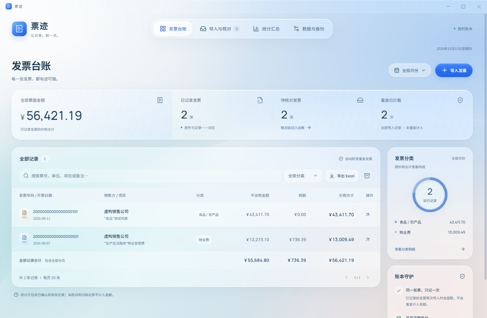

<p align="center"></p>

# 票迹 Piaoji

**把发票留在本地，让核对、查重和整理更轻一点。**

票迹是一款面向 Windows 的单机发票管理工具。导入 PDF 或图片，在本地完成文字识别，对照原件核对后记入台账，再按月份、分类和销售方查看汇总。

不需要注册账号，不依赖云端 OCR，也不会将发票或账本上传到服务器。

[下载安装包](https://github.com/KeeVor/invoice-ledger/releases/latest) · [查看版本记录](https://github.com/KeeVor/invoice-ledger/releases) · [反馈问题](https://github.com/KeeVor/invoice-ledger/issues)

> 当前主要支持常见中国增值税电子发票。识别是录入辅助，不是税务验真；号码、日期和金额需要人工核对。



*界面截图使用虚构公司和测试号码，不包含真实票据。*

## 可以做什么

| 能力 | 说明 |
| --- | --- |
| 本地识别 | PDF 优先读取文字层，必要时回退 OCR；图片通过本地模型识别 |
| 对照核对 | 原件预览与字段并排显示，确认后才进入正式台账 |
| 重复拦截 | 支持 20 位数电号码，以及旧版发票代码与 8 位号码组合查重 |
| 台账整理 | 搜索、月份与分类筛选，查看原件，归档或恢复记录 |
| 金额统计 | 查看不含税金额、税额和价税合计，支持按开票时间或首次录入时间汇总 |
| Excel 导出 | 导出当前筛选范围的台账和分类汇总，号码保留为文本 |
| 完整备份 | 同时备份账本、原件和预览，正常退出时按需自动备份 |
| 应用内更新 | 安装版可检查 GitHub Releases，确认下载与安装 |

## 下载与安装

前往 [最新 Release](https://github.com/KeeVor/invoice-ledger/releases/latest)，下载 `Piaoji-Setup-版本号.exe`。

- 支持 Windows x64；安装包内置识别程序和模型，无需另装 Node.js 或 Python。
- 安装包目前没有代码签名，Windows 可能提示未知发布者。请只从本仓库的 Releases 下载。
- 升级前正常退出旧版本，并沿用原安装位置。账本独立于程序目录，升级不会主动删除数据。
- 如使用自行构建的 `win-unpacked` 目录，请保留整个目录，不能只复制主程序；该形式不支持应用内安装更新。

### 更新软件

从 v0.3.0 起，安装版启动后会检查新版本，也可在「数据与备份」中手动检查。

发现新版后，软件不会自动下载或静默安装。你可以选择下载，完成后点击「安装更新并退出」，确认后打开安装程序；更新前不额外创建备份。

**v0.2.2 及更早版本需要手动安装一次新版，才能使用应用内更新。** 如果无法连接 GitHub，也可以从 Releases 手动下载覆盖安装。

## 使用流程

1. 点击「导入发票」，或将 PDF / 图片拖入窗口。
2. 进入「导入与核对」，对照原件检查号码、日期、购销方、金额和分类。
3. 勾选核对确认并保存。相同身份的发票不能重复入账，已归档记录也参与查重。
4. 在「发票台账」中搜索、筛选、查看原件，或导出 Excel。
5. 在「统计汇总」中选择时间口径和月份，查看分类、销售方及月度汇总。
6. 定期在「数据与备份」中创建完整备份，并另存到其他物理设备。

每批最多导入 500 个文件，单个文件不超过 50 MB；PDF 最多 100 页，每页生成一条待核对记录。一张图片请仅保留一张发票。

## 数据、隐私与统计口径

- **数据保存在本机**：默认目录为 `%APPDATA%\Piaoji`。导入时复制归档原件，不依赖聊天软件的临时文件路径。
- **识别不联网**：安装后 PDF 解析和图片识别均在本地运行。检查更新、下载新版以及打开发布页面时需要联网；GitHub 会收到常规网络请求信息，但不会收到发票或账本。
- **备份包含原件**：`.piaoji` 文件是完整备份。恢复会替换当前全部账本与原件，不是合并，也不会额外创建恢复前备份。
- **正常退出自动备份**：有变更时生成，只保留最新 1 份。新备份试解包并通过数据库和文件完整性检查后，才删除旧的自动备份及旧版遗留的更新前、恢复前备份；失败时保留旧备份。手动导出的备份不自动删除。强制结束进程或断电时不保证生成新备份。
- **没有加密**：账本及备份依赖操作系统账户权限保护，请勿公开分享。卸载不会主动删除默认数据目录。
- **金额不是经营结论**：汇总的是票面金额，不代表收入、支出、利润或已报销金额。红字票按负数计入，归档记录不参与统计。
- **录入时间保持稳定**：首次核对并正式保存时记录，之后修改、归档或恢复有效状态不改变它；按录入时间汇总使用本机时区。

## 当前限制

- 不保证覆盖全部票型和版式；模糊截图、复杂拍照、税号中的 `0/O` 等字符尤其需要人工核对。
- 暂不自动处理同页多票、跨页附表，以及多类目逐行分摊。
- 暂未提供税务验真、红冲关联、报销审批、历史 Excel 导入或云端同步。
- 不支持把正在使用的 SQLite 账本放到网络共享目录供多台电脑并发写入。
- 尚未完成另一台干净 Windows 电脑上的安装与覆盖升级验证。详细测试范围见 [测试说明](docs/TESTING.md)。

## 本地开发

需要 Windows x64、Node.js 24+、Python 3.12 和 [uv](https://docs.astral.sh/uv/)。开发环境安装依赖可能需要联网。

```powershell
git clone https://github.com/KeeVor/invoice-ledger.git
cd invoice-ledger
npm ci
npm exec -- install-electron
npm run python:setup
npm run dev
```

常用命令：

| 命令 | 用途 |
| --- | --- |
| `npm run dev` | 启动 Vite 和 Electron 开发环境 |
| `npm run build` | TypeScript 检查及前端、主进程构建 |
| `npm test` | 数据库、备份、提示文案和更新逻辑单元测试 |
| `npm run test:python` | Python 发票字段解析测试 |
| `npm run test:updates:ui` | 更新界面与 IPC 的隔离桌面测试 |
| `npm run dist` | 构建包含本地识别引擎的 Windows 安装包 |

开发时可通过 `INVOICE_LEDGER_DATA_DIR` 指定隔离账本目录。安装版忽略此变量，避免意外切换正式数据位置。

### 代码结构

```text
src/                  React 界面、共享类型和基础控件
electron/             主进程、SQLite、文件与备份、更新服务
python/               PDF 解析与本地 OCR 工作进程
scripts/              开发、构建、模型准备和集成验证
tests/                TypeScript 与 Python 单元测试
build/                安装包图标等源资源
docs/                 测试、发布与维护说明
.github/workflows/    持续集成与 Release 构建
```

技术栈：Electron、React、TypeScript、Vite、better-sqlite3、Python、pdfplumber、RapidOCR 和 ONNX Runtime。主进程与界面通过受限 IPC 通信，渲染进程不直接访问 Node.js。

### 发布版本

版本号由 `package.json` 管理。推送匹配的 `v版本号` 标签后，GitHub Actions 在 Windows 上运行测试、构建安装包，并向 Release 上传安装包、差分信息和 `latest.yml` 更新元数据。

具体步骤及更新安全边界见 [发布说明](docs/RELEASING.md)。运行时依赖的第三方许可见 [THIRD_PARTY_NOTICES.md](THIRD_PARTY_NOTICES.md)；安装包另附 Python 依赖许可。

## 反馈与贡献

欢迎通过 [Issues](https://github.com/KeeVor/invoice-ledger/issues) 提交问题或建议。请说明软件版本、Windows 版本、操作步骤和实际结果。

**请不要直接上传真实发票、税号、公司信息或账本备份。** 如需提供样例，请先脱敏，或使用虚构数据复现。

仓库公开不代表已授予任意使用、修改或再分发的开源许可；在项目明确提供许可证前，请先与维护者确认相关授权。
